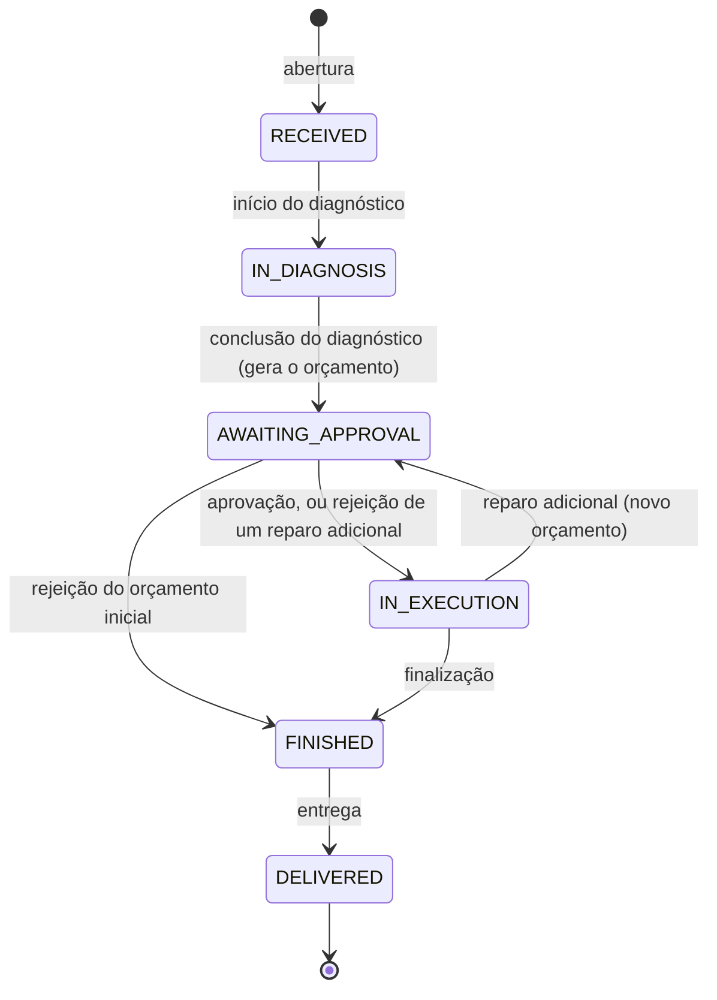

# Sistema Oficina Mecânica

[](https://github.com/FIAP-18SOAT-G93/auto-repair-shop-api/actions/workflows/ci.yml)
[](https://github.com/FIAP-18SOAT-G93/auto-repair-shop-api/actions/workflows/security.yml)
[](https://sonarcloud.io/project/overview?id=FIAP-18SOAT-G93_auto-repair-shop-api)

Primeira versão do Sistema Integrado de Atendimento e Execução de Serviços de uma oficina mecânica. Tech Challenge da Fase 1 da pós-graduação FIAP SOAT.

## Objetivo

O projeto tem como objetivo substituir as anotações manuais e as planilhas de uma oficina mecânica por um fluxo digital da ordem de serviço, da recepção do veículo à entrega. A API cadastra clientes e veículos, abre a ordem de serviço, registra o diagnóstico com os serviços e as peças, gera o orçamento automaticamente e dá baixa no estoque. O cliente acompanha o andamento e aprova ou rejeita os orçamentos pelo aplicativo, e o gestor mantém o catálogo, repõe o estoque e acompanha o tempo médio de execução dos serviços. O domínio foi modelado com Domain-Driven Design, com foco em qualidade de software e segurança.

## Descrição da solução

A API REST é usada pela equipe da oficina e pelo cliente

| Quem      | O que faz                                                                                                                                                   |
| --------- | ----------------------------------------------------------------------------------------------------------------------------------------------------------- |
| Atendente | cadastra clientes e veículos, abre a ordem de serviço, registra a decisão do cliente sobre o orçamento e a entrega do veículo                               |
| Mecânico  | faz o diagnóstico, inclui serviços e peças (com baixa no estoque), conclui o diagnóstico, registra reparos adicionais e finaliza a ordem de serviço         |
| Gestor    | mantém o catálogo de serviços e o estoque de peças e insumos, registra entradas de estoque, vê as peças indisponíveis e acompanha o tempo médio de execução |
| Cliente   | com o CPF/CNPJ e o código de acompanhamento, acompanha as próprias ordens de serviço e aprova ou rejeita os orçamentos                                      |

O orçamento é gerado automaticamente ao fim do diagnóstico, com base nos serviços e nas peças incluídos, e o cliente é avisado. Cada ação muda o status da ordem de serviço, seguindo as regras de transição do domínio, e cada mudança fica registrada no histórico.

## Modelagem do domínio (DDD)

- [Modelagem do domínio no Miro](https://miro.com/app/board/uXjVHgZ7nnk=/) (Event Storming, agregados, contextos delimitados, subdomínios e C4)
- [Domain Storytelling](docs/ddd/domain-storytelling.pdf)
- [Event Storming](docs/ddd/event-storming.pdf)
- [Domínio e subdomínios](docs/ddd/dominio-e-subdominios.pdf)
- [Entidades e objetos de valor](docs/ddd/entidades-e-objetos-de-valor.pdf)
- [C4 — níveis 1 a 3](docs/ddd/c4.pdf)
- [Linguagem ubíqua](docs/ddd/linguagem-ubiqua.md)
- [Relação entre a modelagem e o código](docs/ddd/relacao-com-o-codigo.md)
- Vídeo de apresentação:

## Tecnologias

| Área                  | Tecnologia                                                                          |
| --------------------- | ----------------------------------------------------------------------------------- |
| Linguagem e framework | Node.js 24, TypeScript 6 (ESM) e NestJS 12                                          |
| Banco de dados        | PostgreSQL 18 e Prisma 7                                                            |
| Autenticação          | JWT (`@nestjs/jwt` e `passport-jwt`) e senhas com bcrypt                            |
| Validação             | `class-validator` e `class-transformer` nas entradas, Zod nas variáveis de ambiente |
| Documentação da API   | Swagger (`@nestjs/swagger`)                                                         |
| Testes                | Vitest (unitários e integração) e Supertest                                         |
| Qualidade             | oxlint, Prettier e TypeScript em modo strict                                        |
| Contêineres           | Docker e Docker Compose                                                             |
| CI e segurança        | GitHub Actions, SonarCloud, OWASP Dependency-Check, OWASP ZAP e `npm audit`         |

## Banco de dados: por que PostgreSQL

As regras mais importantes do domínio dependem de garantias que um banco relacional oferece:

- **Transações:** a inclusão de uma peça na ordem de serviço e a baixa no estoque acontecem juntas ou não acontecem.
- **Atualização atômica com condição:** a baixa usa `UPDATE ... SET quantity = quantity - n WHERE quantity >= n`, e o estoque nunca fica negativo, mesmo com pedidos simultâneos.
- **Travamento de linha:** as alterações na ordem de serviço usam `SELECT ... FOR UPDATE`, para que duas alterações simultâneas na mesma ordem de serviço não se percam.
- **Índice único parcial:** `UNIQUE (vehicle_id) WHERE delivered_at IS NULL` garante uma ordem de serviço aberta por veículo direto no banco.
- **Integridade:** chaves estrangeiras entre a ordem de serviço e os seus itens, orçamentos e histórico, e restrições `CHECK` nos preços e no saldo do catálogo e do estoque.

O Prisma traz as migrations versionadas e os tipos gerados a partir do schema.

## Arquitetura

### Monólito modular em camadas

Aplicação é um monólito modular, o código é dividido em módulos NestJS, um para cada contexto delimitado identificado no Event Storming. Cada módulo tem as próprias regras e tabelas, e só conversa com os outros por interfaces bem definidas. Essa separação mantém o código organizado pelo negócio, e não pela tecnologia, e permite que um módulo seja extraído para um serviço próprio no futuro, se for necessário.

| Módulo          | Contexto delimitado | Tipo de subdomínio | Responsabilidade                                                                       |
| --------------- | ------------------- | ------------------ | -------------------------------------------------------------------------------------- |
| `service-order` | Atendimento         | core               | ordem de serviço, orçamento, histórico de status, acompanhamento do cliente e métricas |
| `customer`      | Cadastro            | suporte            | clientes (CPF/CNPJ) e veículos (placa)                                                 |
| `catalog`       | Catálogo e Estoque  | suporte            | serviços e peças ou insumos, com o controle do estoque                                 |
| `auth`          | Identidade e Acesso | genérico           | usuários da equipe, login e controle de acesso por função                              |

### Camadas de cada módulo

| Camada           | Responsabilidade                                                                                                                               |
| ---------------- | ---------------------------------------------------------------------------------------------------------------------------------------------- |
| `domain`         | as regras de negócio, agregados, objetos de valor, eventos e erros de domínio. É TypeScript puro, sem NestJS nem Prisma, e é testado sem banco |
| `application`    | os casos de uso que carregam os agregados, executam os comandos do domínio, gravam o resultado e controlam a transação                         |
| `infrastructure` | os detalhes técnicos como repositórios com Prisma e adaptadores para os outros módulos                                                         |
| `presentation`   | a entrada HTTP com controllers, DTOs validados e documentação do Swagger                                                                       |

Regras de dependência:

- O domínio não depende de nenhuma outra camada. As regras de negócio ficam nele, nunca nos controllers ou nos repositórios.
- O caso de uso depende de interfaces (os repositórios e as portas), e a infraestrutura as implementa. Trocar o banco ou o ORM não muda o domínio nem os casos de uso.
- Os módulos se integram pelos casos de uso, nunca acessando as tabelas uns dos outros. Por exemplo, a ordem de serviço consulta o cadastro pela porta `CustomerDirectory` e o estoque pela porta `PartStock`, e cada porta tem um adaptador que chama os casos de uso do outro módulo.
- Entre agregados, a referência é sempre por ID (`customerId`, `vehicleId`, `serviceId`, `partId`).

### Código compartilhado (`shared`)

A pasta `src/shared` não é um contexto delimitado e não tem regras de negócio de nenhum módulo. Ela guarda a base que todos os módulos usam, organizada nas mesmas camadas:

| Camada           | O que tem                                                                                                                                                                                                                                                           |
| ---------------- | ------------------------------------------------------------------------------------------------------------------------------------------------------------------------------------------------------------------------------------------------------------------- |
| `domain`         | as bases `Entity` e `AggregateRoot` (que guarda os eventos de domínio), a interface `DomainEvent`, os objetos de valor `Money` e `Quantity` e o `DomainError` com as suas categorias: validação, não encontrado, conflito e autenticação                            |
| `application`    | as portas `UnitOfWork`, que abre a transação dos casos de uso, e `NotificationGateway`, a camada anticorrupção do aviso ao cliente                                                                                                                                  |
| `infrastructure` | o `PrismaService` e o `PrismaUnitOfWork`, que propaga a transação para os repositórios com `AsyncLocalStorage`; o filtro que converte o `DomainError` em resposta HTTP (400, 404, 409 ou 401); a validação das variáveis de ambiente; o `LoggerNotificationGateway` |

O `shared` não importa nada dos módulos, e os módulos importam do `shared`. Assim, `Money` e `Quantity` têm uma única definição para o catálogo e para a ordem de serviço, e a regra que transforma um erro de domínio em status HTTP fica num lugar só.

### Ciclo de vida da ordem de serviço



Qualquer outra transição é recusada pelo domínio. Regras principais:

- Um veículo só pode ter uma ordem de serviço aberta (não entregue), garantido no caso de uso e por um índice único parcial no banco.
- O preço do serviço e da peça é congelado no item quando ele entra na ordem de serviço.
- A peça tem baixa no estoque no momento da inclusão, na mesma transação. Sem saldo, a API responde 409 e nada é gravado.
- Cada reparo adicional gera uma nova versão do orçamento, só com os itens novos. O valor a pagar é a soma dos orçamentos aprovados.
- A decisão sobre o orçamento informa a versão consultada, para que um pedido repetido ou atrasado não decida uma versão que o cliente não viu.
- A rejeição estorna as peças do orçamento rejeitado. A do orçamento inicial finaliza a ordem de serviço sem execução, e a de um reparo adicional retoma a execução.
- O tempo de execução soma os períodos em "Em execução" e não conta a espera pela aprovação de um reparo adicional.

## Estrutura de pastas

```
src/
  modules/
    auth/             Identidade e Acesso: usuários, login e funções
    customer/         Cadastro: clientes e veículos
    catalog/          Catálogo e Estoque: serviços, peças e insumos
    service-order/    Atendimento: ordem de serviço, orçamento, acompanhamento e métricas
      domain/
      application/
      infrastructure/
      presentation/
      testing/        fakes usados nos testes unitários
  shared/
    domain/           Money, Quantity, Entity, AggregateRoot e erros de domínio
    application/      UnitOfWork e NotificationGateway
    infrastructure/   Prisma, validação do ambiente, filtro de erros e notificação
  health/             rota de saúde usada pelo Docker
prisma/               schema, migrations e seed
test/                 testes de integração (e2e)
docs/
  ddd/                Domain Storytelling, Event Storming, subdomínios, entidades, C4, linguagem ubíqua e relação com o código
  postman/            coleção de requisições
  security/           relatório de vulnerabilidades e evidências
```

## Pré-requisitos

- Para rodar com Docker: [Docker](https://www.docker.com/get-started/) e [Docker Compose](https://docs.docker.com/compose/install/).
- Para rodar localmente: Node.js 24 e um PostgreSQL acessível (o do Docker Compose serve).

## Como rodar com Docker

1. Crie o arquivo `.env` a partir do modelo `.env.example`:

   ```bash
   cp .env.example .env              # Linux/macOS
   Copy-Item .env.example .env       # Windows (PowerShell)
   ```

   Troque o `JWT_SECRET` por um valor aleatório de pelo menos 32 caracteres e, se quiser, o `DB_PASSWORD`. O comando para gerar um segredo está no próprio `.env.example`.

2. Confira se as portas `5432` (PostgreSQL) e `3000` (API) estão livres.

3. Suba tudo:

   ```bash
   docker compose up --build
   ```

   O Compose sobe três serviços, nesta ordem:

   | Serviço    | O que faz                                                        |
   | ---------- | ---------------------------------------------------------------- |
   | `postgres` | banco PostgreSQL 18, com os dados em um volume                   |
   | `migrate`  | aplica as migrations, carrega os dados de demonstração e termina |
   | `api`      | a API, depois que o `migrate` termina com sucesso                |

4. Acesse:
   - Documentação da API (Swagger): http://localhost:3000/docs
   - Saúde da API: http://localhost:3000/health

Para parar:

```bash
docker compose down       # remove os contêineres e mantém os dados
docker compose down -v    # remove também o volume com os dados do banco
```

## Como rodar localmente

```bash
npm install
docker compose up -d postgres        # ou use um PostgreSQL já instalado
npx prisma migrate dev               # aplica as migrations
npx prisma db seed                   # carrega os dados de demonstração
npm run start:dev                    # API em modo watch
```

A API lê a conexão das variáveis de banco do `.env`.

### Variáveis de ambiente

| Variável         | Descrição                                   | Padrão        |
| ---------------- | ------------------------------------------- | ------------- |
| `NODE_ENV`       | `development`, `production` ou `test`       | `development` |
| `PORT`           | porta da API                                | `3000`        |
| `DB_HOST`        | host do PostgreSQL                          | —             |
| `DB_PORT`        | porta do PostgreSQL                         | `5432`        |
| `DB_USER`        | usuário do banco                            | —             |
| `DB_PASSWORD`    | senha do banco                              | —             |
| `DB_NAME`        | nome do banco                               | —             |
| `JWT_SECRET`     | segredo do JWT, com no mínimo 32 caracteres | —             |
| `JWT_EXPIRES_IN` | validade do token (ex.: `15m`, `1h`, `7d`)  | —             |

As variáveis são validadas na inicialização. Se alguma estiver ausente ou inválida, a API não sobe e informa qual é.

## Como testar

```bash
npm test               # testes unitários (domínio e casos de uso, sem banco)
npm run test:cov       # testes unitários com o relatório de cobertura
npm run test:e2e       # testes de integração com o PostgreSQL
npm run lint           # verificação de lint com oxlint
npm run typecheck      # verificação de tipos do TypeScript
npm run format:check   # verificação de formatação com Prettier
npm run build          # compilação
```

Os testes do domínio foram escritos antes da implementação, método TDD.

**Cobertura:** o `npm run test:cov` mede as pastas `domain/`, onde ficam as regras de negócio, e falha se a cobertura ficar abaixo de 80%. A cobertura atual é de 100% em linhas, ramos e funções. O relatório fica na pasta `coverage/` e também é publicado a cada execução do CI e no [SonarCloud](https://sonarcloud.io/project/overview?id=FIAP-18SOAT-G93_auto-repair-shop-api).

**CI:** cada pull request roda o lint, a verificação de tipos, a formatação, o build, os testes unitários com cobertura, os testes de integração com um PostgreSQL real, a montagem das imagens Docker e as análises de segurança.

## Documentação da API

Com a API no ar, o Swagger fica disponível em http://localhost:3000/docs, com as rotas agrupadas por seção.

### Autenticação

**Equipe:**

1. Entre com `POST /auth/login` usando um dos usuários de demonstração.
2. Copie o `accessToken` da resposta e cole no botão **Authorize** do Swagger.

**Cliente:**

1. Abra uma ordem de serviço com o atendente (`POST /service-orders`). A resposta traz o `trackingCode` (ex.: `K7QM-4XPA`), que vai no recibo do cliente.
2. Entre com `POST /auth/customer`, informando o CPF/CNPJ do cliente e o código de acompanhamento (`trackingCode`).
3. Com o token do cliente, use as rotas da seção **Acompanhamento do cliente**.

### Usuários de demonstração

O [seed](prisma/seed.ts) cria três usuários da equipe, todos com a senha `Oficina@123`:

| Função    | E-mail                  |
| --------- | ----------------------- |
| Atendente | `atendente@oficina.com` |
| Mecânico  | `mecanico@oficina.com`  |
| Gestor    | `gestor@oficina.com`    |

Também cria seis serviços no catálogo (como troca de óleo, alinhamento e revisão de freios) e seis peças e insumos.

### Exemplos de requisição

A coleção do Postman em [`docs/postman/auto-repair-shop-api.postman_collection.json`](docs/postman/auto-repair-shop-api.postman_collection.json) tem o roteiro do ciclo completo de uma ordem de serviço: login da equipe, abertura, diagnóstico com baixa no estoque, aprovação pelo cliente, reparo adicional rejeitado, finalização, entrega e as consultas do gestor, além dos erros esperados (peça sem saldo, versão errada do orçamento e acesso negado).

1. No Postman, use **Import** e escolha o arquivo da coleção.
2. Com a API no ar, abra a coleção e clique em **Run** para executar as requisições em ordem.

## Segurança

O [relatório de vulnerabilidades](docs/security/relatorio-vulnerabilidades.md) traz os resultados do SonarCloud, do OWASP Dependency-Check e do OWASP ZAP.

## Limitações conhecidas e evoluções

- **Notificação:** o aviso ao cliente só é registrado em log. A integração com um canal externo (e-mail ou WhatsApp) fica para uma próxima versão.
- **Pagamento:** o pagamento da ordem de serviço fica para uma próxima versão.
- **Métricas:** o tempo médio é calculado em memória a partir das ordens de serviço finalizadas. A média por serviço usa a duração da ordem de serviço inteira, porque o sistema não registra o início e o fim de cada serviço.
- **Segurança:** os cabeçalhos HTTP de segurança e o `--ignore-scripts` no build, apontados no relatório de vulnerabilidades, ficam para uma próxima versão.

## Licença

MIT
